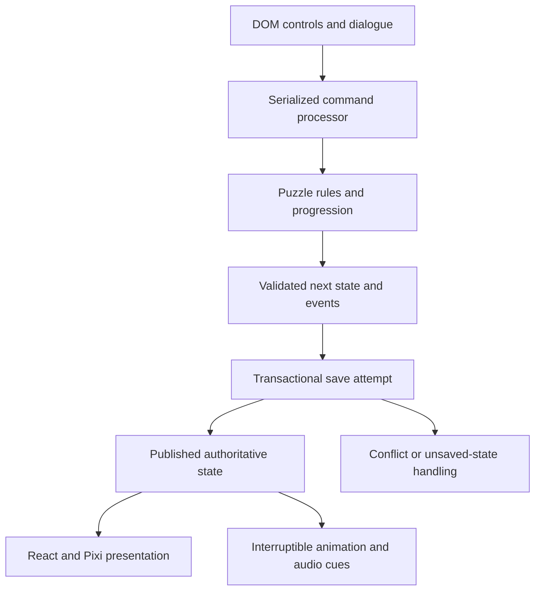

# The Witches' Road — implementation plan

Phases A through G and immersive passes I1 through I6 are complete for the local game. Physical phone and Safari verification remain open. [Immersive presentation plan](docs/IMMERSIVE_PRESENTATION_PLAN.md) · [Phase reports](docs/PHASES.md) · [Release verification](docs/PHASE_G_REPORT.md)

Current product decision: level hints, hint lamps, automatic answer boards and showcase assistance have been removed. Essential puzzle clues, rules and manual undo/reset remain. Historical supplied reference documents are preserved as originally received.

Audio is required presentation, following the user's 4 November 2026 correction. The Road opens through an explicit sound-start gesture. Every room has music/ambience, and failed starts offer Retry and save export before play resumes. Players retain mute and bus-volume controls after entry. Printed clues and captions remain available for accessibility.

Scenery and animations fill the browser viewport. The presentation plan integrates controls into props, documents and object close-ups and supersedes the earlier fitted-scene and permanent-ledger guidance. I1 established the responsive cottage, and I2 extended the shared world and traveller's kit to all locations. I3–I4 converted the seven trial rooms to native working objects. I5 moved the cottage return and library renewal onto the rug, door and desk. I6 finished the room framing, field notes, audio transitions and whole-game review. [Presentation plan](docs/IMMERSIVE_PRESENTATION_PLAN.md) · [I1](docs/IMMERSIVE_I1_REPORT.md) · [I2](docs/IMMERSIVE_I2_REPORT.md) · [I3](docs/IMMERSIVE_I3_REPORT.md) · [I4](docs/IMMERSIVE_I4_REPORT.md) · [I5](docs/IMMERSIVE_I5_REPORT.md) · [I6](docs/IMMERSIVE_I6_REPORT.md)

## 1. Product and scope

Build a browser puzzle game whose rooms, characters, and props act as an elaborate login for the fictional Westview Public Library. The player stamps a borrowing alias, follows account recovery along the Road, solves five mathematical trials, returns to the opening cottage, and opens a usable fictional library account. The account supports renewing *A Short Introduction to Passwordless Authentication*, inspecting discoveries, revisiting rooms, signing out, and starting another journey.

This plan adopts the supplied architecture document and concept brief as the product baseline. Their imperative text describes proposed game behavior; it does not authorize actions outside the user's request to create this plan. The original documents and all seven pictures are preserved in [references](docs/references/README.md). The module boundaries, state clarifications, initial puzzle arrangements, production dimensions, and task breakdown below are implementation decisions made from that baseline.

The initial release uses fictional credentials, browser-local saves, static hosting, and authored puzzle instances. The attempted password is a disposable spell used for the dot-theft joke; the real in-game password is a five-card ritual. Real authentication, a backend, cross-device saves, offline installation, and procedural puzzle generation are outside this release's scope. A later requirement for real accounts would require a separate authentication design.

Target 25–45 minutes for a first story journey and 8–12 minutes for showcase mode. These are playtest targets, not established timings. Both modes share content and rules but use separate run slots. Showcase uses the same unguided puzzles in a separate slot. The user removed level hints on 4 November 2026; recheck playthrough timing after that change.

Release scope includes the complete required route, optional garden and Vision annex, the supplied 34-interaction catalogue, responsive controls, animation, sound, save recovery, and an illustrated DOM fallback. Stage delivery so the full route works before expensive art and optional encounters are added.

## 2. Canonical player journey

| Stop | Interaction and prerequisite | Saved result |
|---|---|---|
| Sunset cottage | Stamp a fictional alias; submit a disposable attempted spell; Agatha steals its displayed dots | Alias stamped; opening theft recorded |
| Coven threshold | Open recovery after the failed attempt; match labeled tokens to seats using supplied symbols | Placements; threshold opened |
| Jen's kitchen | Enter after threshold; measure four cups with 3- and 5-cup jugs | Kitchen solved; Track Four clue |
| Alice's studio | Enter after kitchen; combine printed remainder clues and dial the code | Studio solved |
| Agatha's cabin | Enter after studio; satisfy four spirit-lamp statements | Cabin solved |
| Lilia's tower | Enter after cabin; arrange five cards, then confirm from the other seat | Tower solved; ritual sequence |
| Rio's greenhouse | Enter after tower; trace every vine clause exactly once | Greenhouse solved |
| Cottage return | Return after greenhouse; inspect the now-familiar props; activate the visible unbinding stitch or equivalent button; use knocker | Unbinding completed; first sign-in recorded |
| Library account | Renew book; inspect receipt, notebook and rooms; sign out or start a fresh slot | Renewal recorded; completed run retained |

Completed rooms remain reachable through the ledger map. Revisits preserve completion. The map derives unlocked locations from progression state; a development-only scene picker must not ship as a route bypass.

The sign-in predicate is exactly: **stamped alias present + kitchen, studio, cabin, tower and greenhouse solved + unbinding completed**. The knocker appearance and `SIGN_IN` handler use the same predicate. Command handling also checks that the player is at the cottage and in a valid phase. Early use explains the next missing condition.

The unbinding is a clearly offered finale action, with gesture and button equivalents. It is required even though `agatha.unbinding` appears in the source's discovery catalogue. Remember me, Vision, rabbit discoveries, television references, timers and animations add no conditions to sign-in. Audio starts at entry; it is not an additional saved trial or seal.

Remember me remains optional on both arrival and return. Solving its garden enables recognition for that run slot after its first successful sign-in. Signing out returns to the cottage with trials and unbinding intact. A remembered completed slot offers Continue to library; other completed slots offer the ordinary knocker. `FORGET_ME` disables recognition without erasing garden completion. A new journey starts a new slot with fresh prerequisites; the collection and preferences remain available.

## 3. Application architecture

| Area | Decision | Boundary |
|---|---|---|
| App and interface | React + TypeScript + Vite | Shell, dialogue, settings, journal, semantic controls, account |
| Scene rendering | PixiJS 8, initially WebGL | Layered art, camera, sprite animation, lighting and particles |
| Game logic | Plain TypeScript functions | Legal commands, puzzle evaluation, progression and rewards |
| Saves | IndexedDB behind a repository interface | Validated run snapshots, previous checkpoints, preferences, collection |
| Sound | Web Audio API | Ambient loops, synchronized studio stems, bus gains, captions |
| Interface motion | CSS / Web Animations API | Panels, focus transitions and dialogue presentation |
| Implementation verification | Vitest + Playwright | Enumerators, state/persistence checks and browser journeys |

PixiJS 8 initializes asynchronously and provides a private application ticker; use one application and one active scene ticker, with an initialization failure path. These capabilities support the design above. [PixiJS Application](https://pixijs.com/8.x/guides/components/application)

Use explicit scene bundles, preload the next required room, and unload only resources that no active scene shares. PixiJS supplies promise-based loading and manifest bundles; ownership and reference counting are application responsibilities. [PixiJS Assets](https://pixijs.com/8.x/guides/components/assets)

At kickoff, select mutually compatible stable React, TypeScript, Vite, test-tool and Node versions, pin the chosen versions, and commit the lockfile. Use the React TypeScript template and verify the selected Vite release's runtime requirements then. This plan deliberately does not label an uninstalled version set as compatible. [Vite getting started](https://vite.dev/guide/)



The normal sequence is validate command → calculate candidate state/events → attempt save → publish state → play cues. A save conflict discards the candidate and loads the latest state. A storage failure preserves the candidate in memory with a persistent Unsaved status, Retry and Export; play and major rewards can continue after the failed attempt. This explicitly resolves the supplied document's tension between waiting for a save and permitting continued play after failure.

Rules never depend on a timer, sprite callback, audio event or React render. Renderers consume snapshots and events; they cannot directly award a seal or rewrite a solution. Keep frame-by-frame coordinates outside React state. A static illustrated DOM view uses the same commands and state if Pixi initialization or context recovery fails.

### Proposed repository structure

```text
src/
  app/                  boot, shell, account, loading/error views
  game/                 state, validation, commands, progression, events
  puzzles/              kitchen, studio, cabin, tower, greenhouse, garden, vision
  scenes/               controllers, layers, lifecycle, viewport transform
  content/              scene/prop manifests, dialogue, instances, discoveries
  ui/                   semantic controls, detail panels, map, notebook
  effects/              cue scheduler, motion preferences, audio engine
  persistence/          IndexedDB, schema migrations, export/import, conflicts
public/assets/          versioned runtime atlases, backgrounds, audio, fonts
art/source/             editable production art; created when production starts
scripts/                content/asset validation and puzzle enumerators
tests/                  rule, integration and browser checks
docs/                   plans, reference material, later compatibility notes
```

Keep supplied reference images under `docs/references/images/`, separate from runtime assets. Reference files must not enter the game's runtime bundle merely because they are in the repository.

## 4. State, commands and persistence

Use a typed, versioned run snapshot. The following is a design contract; referenced puzzle types will be defined during implementation.

```ts
type RunState = {
  schemaVersion: number;
  contentVersion: string;
  runId: string;
  revision: number;
  seed: string;
  mode: 'story' | 'showcase';
  currentScene: SceneId;
  phase: 'arrival' | 'road' | 'return' | 'signedIn';
  alias: string | null;
  arrival: { aliasStamped: boolean; theftRecorded: boolean };
  threshold: { placements: Record<TokenId, SeatId | null>; opened: boolean };
  milestones: {
    unbindingCompleted: boolean;
    hasSignedInOnce: boolean;
    bookRenewed: boolean;
  };
  rememberEnabled: boolean;
  puzzles: {
    kitchen: KitchenState; studio: StudioState; cabin: CabinState;
    tower: TowerState; greenhouse: GreenhouseState;
    garden: GardenState; vision: VisionState;
  };
  journalEntries: ClueId[];
  inventory: ItemId[];
  discoveries: Partial<Record<EggId, DiscoveryState>>;
  statistics: RunStatistics;
};
```

Each puzzle stores its instance/rules version, bounded values, one solved flag and bounded undo history. Start with at most 100 undo entries per puzzle. Tower state also stores arranging/confirming/solved stage, the submitted canonical deck, confirmation selection, and revealed memory-fragment IDs. Store token placements and alias-stamp status explicitly; they cannot be reconstructed reliably from an animation.

Preferences and the device collection are separate records. Preferences include text size, captions, motion level, reveal speed, mute, bus levels and object outlines. The collection contains stable discovery IDs and cosmetic unlocks across runs. An award updates the run and collection atomically. Seals and available exits are derived from puzzle completion; do not maintain a second editable seal counter.

Core commands include `STAMP_ALIAS`, `SUBMIT_ATTEMPTED_SPELL`, `START_RECOVERY`, `PLACE_COVEN_TOKEN`, `FILL_JUG`, `EMPTY_JUG`, `POUR_JUG`, `DIAL_CODE`, `TOGGLE_SPIRIT_LAMP`, `CHECK_LAMPS`, `CUT_DECK`, `SWAP_FIRST_CARDS`, `SUBMIT_DECK`, `CONFIRM_DECK`, `TRACE_VINE`, `TOGGLE_MUSHROOM`, `SUBMIT_IDENTITY`, `INSPECT_PROP`, `UNDO_PUZZLE_MOVE`, `RESET_PUZZLE`, `ENTER_SCENE`, `COMPLETE_UNBINDING`, `SIGN_IN`, `SIGN_OUT`, `RENEW_BOOK`, and `FORGET_ME`.

Validate command payloads and scene/phase prerequisites before any state change. Alias stamping trims input, rejects empty/control-only input, limits it to a documented short display length, and renders it as text. Keep attempted spell text only in transient UI memory and clear it immediately after submission; saved events contain a generic dot count, never the text. Record logical theft on accepted submission, so interruption restores the completed pose without requiring replay.

Repeated sign-in, renewal, trial completion and discovery awards are idempotent. Stable IDs prevent duplicates across fast clicks or reloads. Serialize local commands and tag cue batches with the accepted command ID. No hint or suggested-move command is exposed to players. Undo affects only the active unsolved puzzle; practice copies cannot revoke completion or award new progression. Clearly distinguish puzzle reset, practice reset, new journey and erase-all-data.

### Save behavior

| Situation | Implementation behavior |
|---|---|
| Accepted persistent command | Compare expected revision; write next run, previous checkpoint and applicable collection changes in one transaction; publish after its result |
| Normal load | Validate schema/content version, instance IDs, ranges, solved-state consistency and references; restore final visual poses |
| Corrupt snapshot | Keep original available for export; try previous valid checkpoint; offer a new slot as a separate action |
| Older supported save | Apply explicit migration steps; retain the source backup until the migrated save succeeds |
| Unsupported content version | Explain incompatibility; preserve export; offer a new slot; never silently remap puzzle rules |
| Quota, blocked storage or write failure | Continue with a visible Unsaved state, in-memory checkpoint, Retry and Export; never display Saved |
| Retry after unsaved play | Compare the original persisted base revision before writing the dirty snapshot; if another tab changed it, preserve/export the unsaved branch and load latest rather than overwrite |
| Second-tab conflict | Transactional revision check rejects stale action; reload latest and ask player to repeat it; BroadcastChannel is notification only |
| Export/import | Export versioned JSON; validate size, shape, IDs and bounds; import as a new slot after validation; render imported strings as text |
| Scene travel failure | Preload destination first; keep current room until ready; ignore obsolete load requests; expose Retry or same-rules DOM view |

IndexedDB writes are transactional; structure repository operations around transaction completion, not individual request success. Avoid waiting for fetches, animation or unrelated asynchronous work inside an open transaction. Browser storage retention is a platform limit, so the player-facing save description must say that clearing browser data removes local progress. [MDN IDBTransaction](https://developer.mozilla.org/en-US/docs/Web/API/IDBTransaction)

Pin small authored puzzle definitions to each run's content version. Keep compatible definitions available across releases or provide an explicit migration. A service worker is deferred until offline support and a content-update policy are requested.

## 5. Puzzle implementation contracts

Every module exposes initialization, legal actions, reducer/evaluator, completion predicate, text description, undo/reset and development-only solver validation. Keep numeric parameters and clue wording in the same authored instance. The reference solutions below are fixtures from the supplied design; their correctness and uniqueness must be checked by repository validators during implementation. This planning task has not run those validators.

| Puzzle | Authored state and rule | Completion and reference fixture | Player controls and development validation |
|---|---|---|---|
| Kitchen | Start `(small,large)=(0,0)`; capacities `(3,5)`; fill, empty, maximal pour only | Large jug equals 4; reference path `(0,5)→(3,2)→(0,2)→(2,0)→(2,5)→(3,4)` | Labeled fill/empty/pour buttons; BFS validates reachability in development only |
| Studio | Recording number `00–99`; remainders `2 mod 3`, `3 mod 5`, `2 mod 7` | Fixture `23`; validate every candidate in domain | Printed strips, audio mixer channels, digit input and rotary illustration; no candidate-answer board or expiring code |
| Cabin | Initial lamps `0000`; `A⊕B=1`, `B⊕C=1`, `C⊕D=0`, `A⊕C⊕D=1` | Fixture `1011`; enumerate all 16 assignments | Four labeled toggles + Check; submission reports whether the full set of statements holds |
| Tower | Cards Cup/Moon/Tower/Key/Door; initial deck Key, Door, Cup, Tower, Moon; CUT moves first to last; QUARREL swaps first two | Canonical fixture Cup, Moon, Tower, Key, Door; confirmation from other seat is Door, Key, Tower, Moon, Cup | Named move buttons + Undo; separate confirmation panel; permutation search is used only by validators |
| Greenhouse | Start C Seed; nodes A Memory, B Breath, C Seed, D Bloom, E Earth; edges AB, BC, CA, AD, DE, EA, CD | Traverse all 7 undirected edges once, end D; fixture C→B→A→C→D→E→A→D | Adjacent-node buttons or drawing; normalize undirected edge IDs; accept every valid trail; undo/reset for dead ends |
| Garden, optional | 8-cap ring; caps 1 and 5 initially lit; a click toggles itself and adjacent caps with wraparound | All lit; fixture clicks 3 and 7 | Number/shape/lit descriptions and preview; enumerate 256 parity patterns in development validation |
| Vision, optional | Four stations and maintenance slips; casing swaps N↔E then E↔S; module swap N↔W | Original Brass casing ends South; original M1 ends West; printed identity policy follows module, so answer West | Readable transfer table, selectable station; simulate swaps for explanation |

Tower's four clues are: Tower immediately follows Moon; exactly two cards separate Moon and Door; Cup precedes Key; Key precedes Door. Enumerate all 120 orders to verify one match, and traverse CUT/QUARREL moves to verify reachability from every arrangement. The initial arrangement above is a fixed implementation choice, saved with its instance ID.

After a valid first submission, lock the canonical deck and persist the confirming stage. The opposite seat is labeled and a nick marks table orientation. Let the player select a five-card sequence in displayed order, then reverse that input **once** before comparing it with the canonical deck. Keep labels upright; merely showing the reversed answer and asking Continue would remove the confirmation puzzle. A wrong confirmation preserves the arranging result and lets the player retry.

Greenhouse drawing resolves to the same adjacent-node commands as buttons. Crossing lines are not extra graph vertices; bridge them visually. Players can manually undo or reset a dead end. No suggested route or automatic recovery action is offered.

Vision uses four visible stations, with two voiced claimants for the dialogue if desired. This resolves the source's two-terminal introduction and four-station mechanics. The printed fictional policy determines correctness; a philosophical opinion does not.

The threshold is a tutorial, not a sixth substantial mathematical trial: author matching symbol/affinity labels together, include Sharon's valid leaf match, allow selection then placement instead of requiring drag, and preserve undo. All required puzzle knowledge is available in the room and journal; recognition of television references is never necessary.

## 6. Presentation, accessibility and effects

Use a shared 640 × 360 scene coordinate system, side-view exteriors and consistent shallow isometric interiors. [Asset direction](docs/ASSET_DIRECTION.md) maps every supplied picture to the production system and specifies bundles, animation priorities and review gates.

React owns all required text, inputs and buttons. Each prop definition supplies a stable ID, scene position, hotspot, accessible name, reading order, inspection text, availability and command. Derive canvas placement, DOM overlays and scene action-list entries from it. One viewport transform handles fit/letterbox scale and offsets for art and overlays. Scene coordinates must not independently drift from hotspots.

On desktop, use a large scene with dialogue below and a collapsible notebook. On portrait phones, retain the complete-room overview and open the selected puzzle in a larger detail panel. Use touch targets at least approximately 44 CSS pixels, readable live text and selection/placement equivalents for dragging. In action-list mode remove duplicate overlays from tab order. Restore focus when a panel closes, focus the new scene description after travel, and support Escape, Enter and Space consistently.

Motion, color and sound always have other expressions: volume readouts, lit/unlit labels, selected card names, node-route text, captions and explicit seat labels. Visual typewriter text is exposed immediately to assistive technology. Apply system reduced motion and the saved override to both DOM and Pixi; use still perspectives for the tower change.

Each named cue declares affected props, start pose, duration, final pose, cancellation and reduced-motion still. Skip resolves to the final pose. Publish accepted completion after the save attempt and before playing a reward. A successful save lets a reload during the cue restore completion; a failed save retains completion in memory with the visible Unsaved status and export option. Dispose scene listeners, timers, display objects and audio nodes on exit. Pause ambient work while hidden.

Starting timing budgets: object responses 150–350 ms; character jokes around 1–2 seconds; first-view transitions 0.8–1.5 seconds. These are tuning targets. Long dialogue and jokes support Skip, and decorative loops never own puzzle input.

Start audio through **Enter the Road with sound**, following a player gesture. Verify a running context before showing the rooms, time out a hanging start after five seconds and offer Retry plus save export on failure. Retain the saved journey throughout recovery. Use master, ambience, music and effects gains, with player-controlled mute after entry. Each room has an original musical mood and ambience; studio stems share one audio clock and retain alignment on pause/resume. Printed clues carry the full code. Speaker-door gain remains subordinate to master mute. Use original dialogue and musical motifs for the planned advertisements and protection refrain. Browser autoplay policies require explicit handling. [MDN autoplay guide](https://developer.mozilla.org/en-US/docs/Web/Media/Guides/Autoplay)

## 7. Discoveries and authored content

The [discovery backlog](docs/DISCOVERY_BACKLOG.csv) preserves all 34 supplied IDs, triggers, payoffs and progression notes. It adds implementation phase and role. The registry includes the required opening, a required finale interaction, completion flourishes and optional discoveries; it is not a list of 34 sign-in requirements. Its `affects_sign_in` column identifies direct inputs to the final sign-in predicate; the opening still gates access to recovery through the canonical route.

Each runtime entry needs `id`, eligible scenes, prerequisite, accepted-event trigger, threshold if any, cue, notebook entry, replay policy and collection reward. Consuming an event can add a discovery but cannot intercept a legal puzzle command or alter its answer. Persist awards independently of whether their cues finish. The notebook names collected clippings and shows anonymous blanks for undiscovered entries.

The rabbit visits the garden stone, kitchen cupboard and studio speaker in order. The third discovery unlocks spectacles across journeys on the same browser. Lilia's memory fragments retain their revealed flags. The borrowing desk has an explicit Expire session action, and Rio's flower marks the return to the cottage. Resume preserves the borrowing record.

Validate scene exits, prop IDs, dialogue links, assets, discovery prerequisites, puzzle-instance IDs and required-trial registrations before building. Add explicit checks that every discovery is reachable and optional content cannot block leaving its room. The source catalogue is the initial reference scope; any additional show references need their own authored entries and acceptance checks.

## 8. Delivery backlog and dependencies

The focused engineering estimates retain the supplied 18–26 working-day range and assume usable art/audio. Original room illustrations, animation frames, writing and music form a separate production lane; they can extend calendar delivery. Do not promise a release date from the engineering range alone.

| Pass | Tasks and dependencies | Playable endpoint / acceptance gate | Effort |
|---|---|---|---|
| A — complete rules route | A1 pin toolchain and scaffold shell; A2 define state/commands/content instances; A3 implement all five puzzle rules and solvers; A4 add IndexedDB/validation; A5 build threshold, map, unbinding, account and renewal as plain DOM controls | Fresh alias reaches renewal through all required puzzles; refresh retains progress; skipping optional content works; initial rule validators pass | 2–3 days |
| B — cottage proof | Depends A. B1 implement viewport/prop overlay mapping; B2 Pixi lifecycle and DOM fallback; B3 cottage/Agatha/card/theft; B4 optional garden; B5 establish shared UI and style proofs | Opening and garden work by pointer, keyboard and portrait detail view, muted and reduced motion; theft interruption restores final state | 2–3 days |
| C — kitchen and studio | Depends A/B. C1 stage kitchen and liquid responses; C2 timer/mitt and pumpkin cues; C3 studio mixer/phone; C4 synchronized sound stems and captions | Live controls match solvers; Track Four clue persists; full printed clues remain accessible; revisits preserve rewards | 3–4 days |
| D — cabin and tower | Depends C and interior/card style. D1 lamps/submission feedback; D2 manual card moves and undo; D3 opposite-seat confirmation; D4 memory fragments and reduced-motion stills; required audio entry and music throughout the Road | Exact card/seat transformation checked; fresh and resumed confirmation work; no cue can remove a solved trial; real output signal, mute and audio retry verified | 3–4 days |
| E — return and account | Depends D. E1 greenhouse path controls; E2 flower reward; E3 return/rug/prop reveal and unbinding; E4 account receipt, sign-out and Remember me recognition | Complete illustrated story reaches renewal; remembered and ordinary return both work; all valid vine trails accepted | 2–3 days |
| F — optional catalogue (complete) | Vision table and transfer simulation, television and noir encounters, cabin silhouettes, rabbit trail and notebook clippings | All 34 entries have documented triggers and replay behavior. Vision returns to the cottage television. [Verification](docs/PHASE_F_REPORT.md) | 3–5 days |
| G — local release (complete) | Production browser, sound, save recovery, renderer and performance checks. Fingerprinted static package and reproducible lockfile build. | The compiled game passed Chrome and Firefox journeys. The release report records WebKit recovery, device limits and build instructions. [Verification](docs/PHASE_G_REPORT.md) | 3–4 days |

The production lane begins with a cottage style proof, one interior proof, a character/portrait sheet and a card-table detail proof. Reuse placeholders until those establish scale and palette. Then produce C/D room assets, E return/greenhouse assets and F optional assets in phase order. Review art in the actual game viewport before multiplying animation frames.

For an early visual showcase, use a development harness to demonstrate cottage theft, the garden, tower confirmation and the account. Keep the complete plain-controls route as the integration baseline and keep production prerequisites intact.

### First implementation session

1. Choose and pin the toolchain; add dev/build/typecheck and later validation commands.
2. Define authored puzzle instances, `RunState`, command/result types and the shared sign-in predicate.
3. Implement the kitchen rules plus solver, serialized command dispatch and first saved snapshot.
4. Expose the plain-control route shell, then fill the other required rules and account endpoint before adding Pixi art.

## 9. Acceptance and verification plan

These checks define the release acceptance criteria. The phase reports record the results and device limits. [Release verification](docs/PHASE_G_REPORT.md)

| Area | Required evidence |
|---|---|
| Kitchen | Bounded quantities and legal transfers; authored target reachable; reference path valid and shortest under stated operations |
| Studio/cabin | Exactly one studio number within 00–99; exactly one cabin assignment among 16; rendered clues agree with evaluators |
| Tower | Exactly one clue order among 120; legal move graph reaches every order; correct opposite-seat input accepted and wrong/double-reversed input rejected; refresh restores stage |
| Greenhouse | Every accepted path uses exactly all seven edges once with C/D endpoints; reject repeats, nonedges and premature end; valid alternatives accepted; manual undo/reset recover dead ends |
| Garden/Vision | Exhaustively check ring effects and authored solution; simulate all maintenance swaps and printed policy; both remain outside sign-in predicate |
| Required journey | Fresh story run reaches sign-in and renewal with every optional discovery skipped; showcase uses same rules; repeated awards/sign-in/renewal stay singular |
| Saves | Reload after meaningful moves and during rewards; valid previous-checkpoint recovery; unsupported import retained; storage failure visibly unsaved; retry cannot overwrite another tab |
| Content | All referenced IDs resolve; all 34 catalogue entries reachable; wrong answers and optional visits retain a path to required success |
| Accessibility | Keyboard-only route, action-list route, captions/mute, text enlargement and reduced motion reach renewal; focus restored correctly; information survives color removal |
| Responsive layout | Desktop landscape and portrait phone overview/detail controls remain readable, aligned and usable; no required drag, hover-only clue or tiny canvas text |
| Resilience | Simulated asset failure, renderer initialization/context failure, hidden tab and skipped cues preserve state and same-rules fallback |
| Browser/device | Representative current Chrome, Firefox and WebKit journeys; at least one real mobile device for touch, memory and audio behavior; record unavailable coverage |
| Performance | Measure first interaction download, later scene bundles, input responsiveness and repeated-room memory use against budgets below |

Use deterministic unit checks for mathematical contracts and command progression, repository integration checks for transaction conflicts/failures, and browser journeys for real focus, layout, loading and interaction. Viewport emulation does not substitute for real-device performance evidence. Run relevant checks as each pass lands; reserve final cross-browser and content-completeness checks for G.

## 10. Performance, delivery and remaining decisions

Start with a compressed first-interaction download below approximately 5 MB and later room bundles around 1–3 MB, including required audio assets where downloaded. The current original score is synthesized locally and adds no downloaded audio files. Aim for 60 fps on the desktop reference device and a stable 30 fps at reduced effects on the mobile reference device; choose and record those devices during B. Treat these as measured budgets, not guarantees. Keep input responsive while reducing particles, glow layers and renderer resolution when needed.

Use native-resolution pixel assets, nearest sampling, padded/extruded atlases and separate DOM text. A 2048 × 2048 RGBA texture is roughly 16 MiB before GPU overhead; budget decoded memory as well as download size. Keep the current scene and a small shared bundle resident, track shared references and verify memory stabilizes after repeated room changes.

Serve a single document with internal scene IDs on static hosting. Fingerprint runtime bundles and assets; revalidate the entry/content manifest so a release does not mix incompatible content. Validate a clean install and production build, then prepare `dist/` plus run/build/save-scope instructions. Selecting and publishing to a hosting account is a later delivery action.

| Decision to settle during implementation | Default to proceed |
|---|---|
| Exact asset style | Cottage `witch4` composition + `witch3` dusk details; shallow isometric interiors; dimensions and palette in asset plan |
| Versions and runtime | Mutually compatible stable versions pinned at A; record actual installed versions and Node requirements |
| Alias length and text/UI font | Short display alias; finalize limit and licensed readable/pixel accent fonts during A/B |
| Threshold token set and seven vine clause texts | Author explicit labels/symbols and short fictional terms before associated scene production; rules do not depend on external lore |
| Reference franchise coverage beyond the supplied catalogue | Implement named catalogue; author additional references only as a separate scope change |
| Target devices and hosting provider | Establish device baseline in B; prepare portable static output in G, choose provider at delivery |
| Art/audio availability | Track source, dimensions, status and frame count; revise schedule once style proofs establish actual production cost |

Handoff is complete when the source, pinned lockfile, authored content, production asset inventory, validator commands, passing journey evidence, static build and compatibility/save notes are present. This document was the original planning deliverable; current build progress is tracked in the phase reports.
