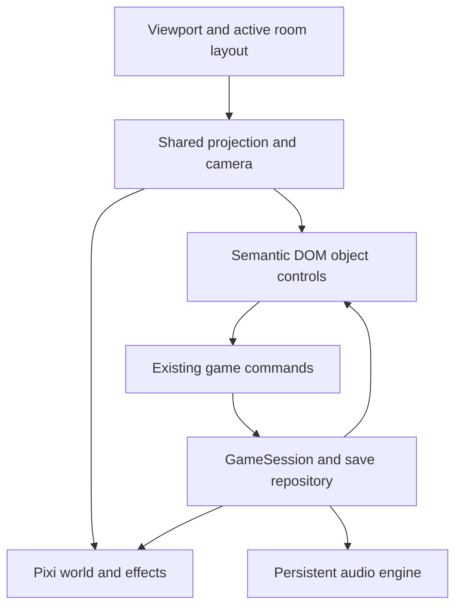

# The Witches’ Road — immersive presentation implementation plan

Prepared 4 November 2026, following the user’s request for scenery and animation to fill the screen and for buttons/cards to belong to the scenery’s design.

**I1 through I6 are complete.** All locations share the full-viewport world and traveller's kit. The seven trial rooms, cottage return and borrowing desk have responsive working objects. Phase F extended the same layout to Vision and the optional catalogue encounters. This plan supersedes the earlier fitted-scene and permanent-ledger guidance. [I4 report](IMMERSIVE_I4_REPORT.md) · [I5 report](IMMERSIVE_I5_REPORT.md) · [I6 report](IMMERSIVE_I6_REPORT.md) · [Phase F report](PHASE_F_REPORT.md)

## 1. Intended player experience

The game world fills the browser’s content viewport from edge to edge. The player enters a cottage, approaches objects, brings a card or table closer, and travels through doors. The room remains the visual setting during interactions, dialogue, menus and rewards.

The main play view has no permanent website header, sidebar, audio banner, footer, page-length puzzle section or normal document scrolling. Longer reading takes place inside an opened notebook, document or receipt. Browser chrome can remain; filling the viewport does not require permission to enter the browser’s Fullscreen API mode.

The visual language stays grounded in the established pixel-art world: worn wood, plum cloth, warm paper, brass, ivy, amber practical lighting and character-specific magic. Inputs, selections and focus states use those materials while retaining readable live text. A paper texture alone is insufficient: each interaction needs a physical place, an opening/closing behavior and a relationship to its room.

Carry forward these requirements:

- Audio starts through the explicit sound-entry gesture and accompanies every room. Mute, volume and failed-start recovery remain available.
- Level hints, automatic answers and suggested moves remain removed. Essential rules and clues remain readable.
- Preserve the authored puzzle operations, progression, saves, old-save defaults, undo/reset behavior, export/import and failure recovery.
- Preserve the show-inspired character silhouettes and the documented distinction between show references and original game locations.
- Accepted state is published after its save attempt and before presentation cues. Animation never awards a seal or owns progression.

## 2. Where the existing interface goes

| Current interface | Proposed presentation |
|---|---|
| Header, branding and room heading | Title/credits at entry; a brief location inscription on arrival. Keep a semantic location heading for assistive technology. |
| Permanent journey ledger and seal cards | A folded Road map in the traveller’s kit. Opening it reveals reachable locations and seals as markings on the map. Doors provide the immediate next-room action. |
| Notebook and discoveries | An actual notebook opening into the foreground. Entries, discoveries and the borrowing card become its pages. |
| Journeys list | Stamped borrowing cards inside the notebook’s journeys folio, with the existing separate-slot behavior. |
| Audio banner | A small, labelled bell/charm with direct mute access. Volume controls live in the themed pause/settings view. |
| Settings and import/export | A restrained menu seal opens a parchment-and-brass settings surface over the room. Keep native form semantics. |
| General feedback strip | Short character dialogue or an object response near the action; captions occupy a protected lower-screen region. Important text is retained in the notebook. |
| Save footer | A compact saved mark in the traveller’s kit. Saving confirmation may fade; unsaved/conflict/recovery states remain visible and actionable. |
| Mobile action-list button strips | Direct interaction with larger, reframed objects is the default. An optional “Room objects” notebook page provides the complete accessible action list. |
| Generic completion card and Continue button | A seal settles onto the borrowing card and the appropriate doorway becomes available, with a clear labelled travel action. |
| Undo/reset rows | Small labelled tools attached to the active puzzle or available in its object menu. Completed seals remain protected. |

The idle view should be dominated by scenery. Aim for persistent interface coverage below approximately 12% on desktop and 18% on phones; validate this visually rather than treating the percentages as an automatic accessibility rule. During a close-up, a physical table, document or instrument may occupy most of the screen.

Persistent controls must stay discoverable: give the map/notebook/menu/audio objects legible labels on focus or selection and a readable touch presentation. Preserve an obvious close/return action. Essential information cannot depend on hovering.

## 3. Room-by-room interaction design

| Location | In-world controls and presentation |
|---|---|
| Entry and cottage arrival | Begin over the full-screen cottage. The door plaque/borrowing card carries “Enter the Road with sound.” Once sound is running, Agatha presents the card for alias stamping and the attempted spell. Inputs sit on that physical card. Generic password pearls travel from its measured visual anchor to Agatha’s necklace/pocket. |
| Cottage interior | Approach the desk, rug and door directly. Inspecting the rug brings the embroidery closer within the room. The same art, objects and positions remain on both visits. Return descriptions change recognition. |
| Coven threshold | Tokens become physical keepsakes/cards placed on the five floor seats. Select a token, then a seat; dragging can be an additional input. Affinity labels remain printed and readable. The trapdoor responds to the existing match submission. |
| Jen’s kitchen | The actual jugs become the working puzzle. Selecting a jug exposes short, material-matched action labels at the water source, drain and other jug. Fill/empty/pour retain their existing maximal quantities. Show volume marks on the vessels and readable values on selection. The oven owns the timer display. |
| Alice’s studio | Mixer faders/channel switches, lyric strips, speaker doors, record direction and telephone dial are the controls. Inspecting the desk brings its equipment forward; the recording number is entered on the telephone. Printed remainder clues stay available alongside the relevant controls. |
| Agatha’s cabin | Operate the four scene lamps directly. Put the four statements on readable spirit slips or an inscription within the lamp-table close-up. The planchette provides Check. Manual undo/reset are small tools on the same table. |
| Lilia’s tower | The five cards are the actual tabletop interaction. CUT and QUARREL are labelled table-edge controls; they remain the legal arrangement operations. The opposite chair changes the viewing composition while labels stay upright and the nick marks the same physical end. Confirmation contains the player’s selections and card backs, never an automatically revealed answer. Memories come from Lilia or physical notes. |
| Rio’s greenhouse | The stones and vines on the greenhouse floor become the single working graph. Approach the bed for a readable close-up on small screens. Drawing, tapping a legal next stone and keyboard activation reach the same commands. Keep the bridged crossing and all five names clear. Retire the duplicate graph below the scenery. |
| Remember me garden | Caps are the controls. Lit/unlit states, numbers and the neighborhood rule remain readable. Recognition and Forget/Remember are integrated with the garden’s sign/borrowing-card marker. The garden stays optional. |
| Return and unbinding | The binding thread lives on the cottage door. Approaching it brings the stitch interaction forward. The five marked stitches and a clear equivalent unbinding action remain available. The knocker then performs sign-in. |
| Library account | The loan book, borrowing card, renewal stamp and receipt become the foreground desk scene. Renew through the stamp/book action. The receipt unrolls from the counter and opens as a readable paper document; sign-out belongs to the exit. |

Opening an object close-up should feel like approaching or lifting that object. Use scene framing, occlusion, consistent lighting and a short transition. Avoid repeating the same puzzle simultaneously in the room and in a separate interface section.

## 4. Full-viewport rendering and layout

### Viewport and aspect ratios

Create a fixed `GameViewport` occupying the available width and dynamic viewport height, with device safe areas. The scene and ambient animation reach every edge. Main gameplay does not scroll the document; notebook/settings/receipt content can scroll inside their own surfaces.

The migration baseline used a 640 × 360 renderer, percentage hotspots, fixed character dimensions and several hard-coded prop/effect coordinates. I1–I2 retain 640 × 360 as the legacy drawing reference while introducing explicit layouts and a camera/projection layer. The shared renderer now resizes to the viewport. I3–I5 refine the individual working instruments and active close-up planes.

Create landscape, intermediate and portrait layout profiles for each room. Profiles declare background layers, character anchors, prop placements, interaction bounds, doorway locations, caption zones and close-up compositions. Choose by available aspect ratio and usable space, with exact boundaries established by the first proof.

Existing 16:9 backgrounds cannot simply be covered into tall phones. For example, a 390 × 844 viewport would retain only about 26% of the width of a covered 16:9 image. Author extended scenery and portrait compositions so essential characters, exits and controls remain reachable. Scale uniformly; recompose scenery and use authored close-ups instead of distorting the artwork or shrinking controls to fit.

Use one authoritative resize/projection controller. It updates the Pixi output, camera and DOM interaction geometry together. Include safe-area and virtual-keyboard adjustments; preserve focused inputs and typed text during layout changes. A visual-viewport change can alter the visible area independently of the layout viewport. [MDN VisualViewport](https://developer.mozilla.org/en-US/docs/Web/API/VisualViewport)

### Shared scene and interaction model

Use one persistent Pixi application for the world. Room controllers replace scene contents and own explicit texture leases. Keep the current global-pool cleanup protection and rendering-error boundary. Recreate the renderer only for an actual recovery need, with the semantic interface still usable.

Each interactive prop should declare a stable ID, layout anchor, visual bounds, accessible label, reading order, legal actions and optional close-up. A shared projection maps it to Pixi placement and DOM hit targets, and inversely maps pointer input into the active interaction plane. Remove independent coordinate formulas from individual React and renderer components.

Keep the controls as real buttons, inputs, ranges and selectable text. Give them room-specific skins and positions. Do not bake required text into generated artwork. Prefer readable, modest 2D interaction planes for close-ups; avoid separate CSS perspective and canvas transforms that place the same target differently.

Pixi can resize to a window or element; the implementation must coordinate this with its camera and DOM projection through a single resize owner. [PixiJS Resize Plugin](https://pixijs.com/8.x/guides/components/application/resize-plugin)

### Presentation state and navigation

Keep camera position, selected object, open page and close-up state separate from `RunState`. Resizing or closing a page must not change puzzle state. Preserve the existing saved cottage view and preferences. Keep attempted-spell text transient and clear it on submission.

Scene travel should preload/cancel destination requests, validate through the current commands, and swap the rendered scene and interactive manifest together. Inputs must never target a different logical room from the visible one. A failed asset load provides the destination’s themed still/DOM view and Retry, with accepted progression intact.

Menus and close-ups need deliberate focus entry, bounded modal focus where appropriate, Escape-to-close and focus restoration to the originating object. Preserve normal editing keys inside inputs. [WAI modal dialog pattern](https://www.w3.org/WAI/ARIA/apg/patterns/dialog-modal/)

## 5. Animation and asset work

Expand motion into the world: layered mist, foliage, fireflies, practical light, character responses, liquid streams, record/mixer movement and physical reward transitions. Effects follow prop anchors and use the same projection as their targets.

- Separate architecture, foreground and atmospheric layers where needed; produce overscan/portrait art, transparent props and material-matched interface surfaces.
- Add action poses/expressions where the interaction needs them. The current single-pose characters and procedural bobbing remain a starting asset set, not the complete animation specification.
- Resolve each cue to a coherent final pose on Skip, reduced motion, scene exit and reload.
- Keep camera movement gentle and interruptible. Camera movement must not invalidate pointer coordinates mid-stroke; cancel an unaccepted stroke when its interaction plane changes.
- Replace the tower’s whole-frame spin with an environmental inversion around the table. Text, card controls, captions and menu access remain upright and stable.
- Keep the same cottage evidence on both visits. Reframing can change the view; return progression cannot invent earlier rug motifs or props.
- Preserve the original score, independent buses and gesture-based entry. Camera changes and close-ups must not create another audio context or restart synchronized stems.

Record new prompts, variants, layers, anchors and provenance in the existing asset inventory. Export optimized runtime versions during this pass: full-screen output increases rendering cost, and the current raw PNG download sizes already need reduction.

## 6. Responsive, accessible and failure behavior

Portrait layouts place the active object, character and readable information in an authored composition. Phones use tap-to-select and object close-ups with targets at least 44 CSS pixels. Every drag/draw operation retains a tap/button or keyboard equivalent. Keep all four lamp statements available while operating the lamp table, and keep the tarot rules accessible while arranging cards.

Retain labelled states, visible focus, adequate text contrast, large text and reduced motion. Test 200% zoom. Support long fictional aliases and longer dialogue without clipping. Native keyboard input must stay above the phone keyboard; a keyboard opening cannot reset a puzzle or discard accepted moves.

The optional Room objects page exposes available interactions and existing clue text in reading order. Its purpose is accessible control, with no strategy or suggested solutions. At normal mobile sizes, it does not replace the world with permanent button strips.

Save failure/conflict/recovery messages stay visible until resolved, with direct Retry/Export access. Audio failure retains its required-start retry/export flow over the world. Lost canvas/context or unavailable textures retain a viewport-filling still and usable DOM controls. Hidden tabs pause rendering and sound; reopening retains the same state.

## 7. Implementation passes and review gates

Report the visible result, screenshots, checks and remaining issues after every pass before beginning the next one. Keep each conversion playable through the existing commands.

| Pass | Work | Reviewable completion gate |
|---|---|---|
| I1 — complete | Viewport, responsive cottage profiles, shared projection and renderer persistent through reframing. Cottage exterior with Agatha, working borrowing card and full-screen atmosphere. Lossless runtime art exports. | Passed: desktop/portrait coverage, no document scroll or stretched art, reachable props and aligned controls after resizing. [Evidence and tests](IMMERSIVE_I1_REPORT.md). |
| I2 — complete | Shared sound entry, borrowing-card inputs, folded map, notebook, journeys, settings/audio, captions and save/renderer recovery. Navigation uses guarded doors and the map. One world renderer survives travel and slot changes. | Passed: TypeScript, 104 unit tests, production build and 84 desktop/phone-emulation browser checks, including opening, slots/settings, keyboard focus, audio and failure recovery. [Implementation and evidence](IMMERSIVE_I2_REPORT.md). |
| I3 — complete | Physical threshold keepsakes/seats, glass vessels and source tools, mixer/record/cabinets/telephone, and lamps/spirit slips/planchette. The four old puzzle-panel branches and Pixi working drawings are retired. | Passed: TypeScript, 114 unit tests, production build and all 96 desktop/phone-emulation browser checks. Covers legal operations, accepted cues, readable clues, native actions, responsive framing, menu reactivation and renderer/audio continuity. [Implementation and evidence](IMMERSIVE_I3_REPORT.md). |
| I4 — complete | Lilia's two-chair table, Rio's native vine bed and the optional cap ring use shared working geometry. Separate wide and portrait garden paintings fill the viewport. | TypeScript, 125 unit tests, the production build and 108 Chromium checks passed. Coverage includes the opposite seat, cancelled strokes, saved caps, responsive framing, required sound and renderer recovery. [Implementation and evidence](IMMERSIVE_I4_REPORT.md) |
| I5 — complete | The rug, door stitches, knocker, recognition nameplate, renewal stamp and receipt have their own physical controls. | TypeScript, 131 unit tests, the production build and 116 Chromium checks passed. Both journeys reached renewal, held writes protected accepted state, and the receipt was readable during its cue. [Implementation and evidence](IMMERSIVE_I5_REPORT.md) |
| I6 — complete | Portrait cottage and library art, room-specific cameras, printed rules in the field notes, full-viewport effects over still art, and synchronized score fades. | TypeScript, 136 unit tests, the production build and 122 Chromium checks passed. The report records native 200% zoom, Firefox playback, Windows WebKit recovery, performance measurements and device limits. [Implementation and evidence](IMMERSIVE_I6_REPORT.md) |

Phase F delivered Vision and the catalogue encounters using the same scene layout and controls. Phase G verified the local release and documented the remaining device checks. [Phase F report](PHASE_F_REPORT.md) · [Phase G report](PHASE_G_REPORT.md)

## 8. Source changes

| Existing area | Planned change |
|---|---|
| `src/app/App.tsx` | I2: page shell replaced by one `WorldGame` and themed modal documents. Session/audio ownership retained. |
| `src/world/WorldGame.tsx`, `renderer.ts` | I2: persistent viewport renderer, active texture leases, responsive camera, full-world cues and still fallback. Replaces the former `SceneStage` and `WorldCottage` components. |
| `src/scenes/CottageDetails.tsx` | I6: static desk objects and embroidery share the still-art layout and survive canvas recovery. |
| `src/scenes/objects.ts` | Split prop/action declarations from aspect-specific placements. Use stable prop IDs and a shared projection. |
| New viewport/layout modules | Define `SceneLayout`, safe regions, world-to-screen/inverse transforms, active planes and resize coordination. |
| `src/ui/ArrivalCard.tsx` | Carries the fictional credential fields at the cottage. I5 finishes moving the working objects out of the former `PuzzlePanel`. |
| `src/world/InstrumentStage.tsx`, `instruments.ts`, `instruments.css` | I3: native working objects, shared vessel/seat geometry, material-specific close-ups, stateful idle previews and accepted-pour guards. |
| `src/world/RoadTrials.tsx`, `trialLayout.ts`, `roadTrials.css` | I4 adds the two-chair table, shared vine geometry and clockwise cap ring to the instrument stage. |
| `src/world/FinaleStage.tsx`, `finale.css` | I5 adds the rug, timber door, knocker, ledger, renewal stamp and receipt, with projected approach plaques and keyboard focus return. |
| `TarotTable`, `VineMap`, `RuneStitch`, `CottageRug`, `LoanReceipt` | Preserve useful rule/input behavior while moving each into its physical table, floor, door, rug or paper view. |
| `AudioEntrance`, `AudioControls`, `src/audio` | World-integrated entry and controls; continuous existing audio lifecycle and synchronized mixer behavior. |
| `src/style.css` | Replace grid/section framing with world layers, material skins, safe-area layouts and accessible document styling. |
| Content and public assets | Add room layout manifests, art layers/variants, prop states and optimized exports with provenance. |
| Tests and helpers | Retain rule/save coverage; update user-path helpers to open maps/objects and add projection, viewport and interaction tests. |

## 9. Verification and acceptance

The functional baseline is **76 passing unit tests and 62 desktop/phone Chromium browser checks** from Phase E. Adapt selectors and helpers to the new interface while preserving the behaviors they verify. Keep save fixtures and pure puzzle tests; retire assertions tied only to the removed page layout.

Add focused checks for:

- Viewport coverage within one CSS pixel, no main-page scrolling, no permanent header/sidebar/puzzle/audiobar stack, and safe-area placement.
- Landscape, portrait, tablet and ultrawide layouts; minimum 360 × 640 through 2560 × 1440, plus orientation changes and 200% zoom.
- Forward/inverse projection agreement, pointer/keyboard parity, readable clue placement, and target alignment after camera changes/resizes.
- Active input preservation, virtual-keyboard layout, pointer cancellation/lost capture, and a release event carrying the final point.
- Entire first/return journeys, opposite-seat confirmation, recognition, renewal, import/export, stale tabs and failed writes through the new props.
- Audio entry/output/mute, synchronized stems through close-ups and travel, hidden-tab pause/resume and device failure recovery.
- Reduced-motion final poses, Skip, rapid room/view changes, missing textures, unavailable/lost canvas and renderer retry without progress loss.

Capture the idle world, one active interaction and one reward in both desktop and phone layouts for each conversion. Record frame time, render resolution, texture residency and repeated-travel behavior. Target smooth 60 fps desktop and stable 30 fps phone play on named reference devices; validate achievable budgets during I1. Pause ambient work while hidden and retain reduced-motion still rendering. Preserve the existing one-worker browser test configuration for this Windows host; it does not replace real-device performance testing.

Final acceptance: the scenery is the complete play surface; every required interaction has a deliberate physical home; clues and controls remain usable; audio and save behavior remain dependable; and the full required journey works without exposing a second dashboard beneath the world.
